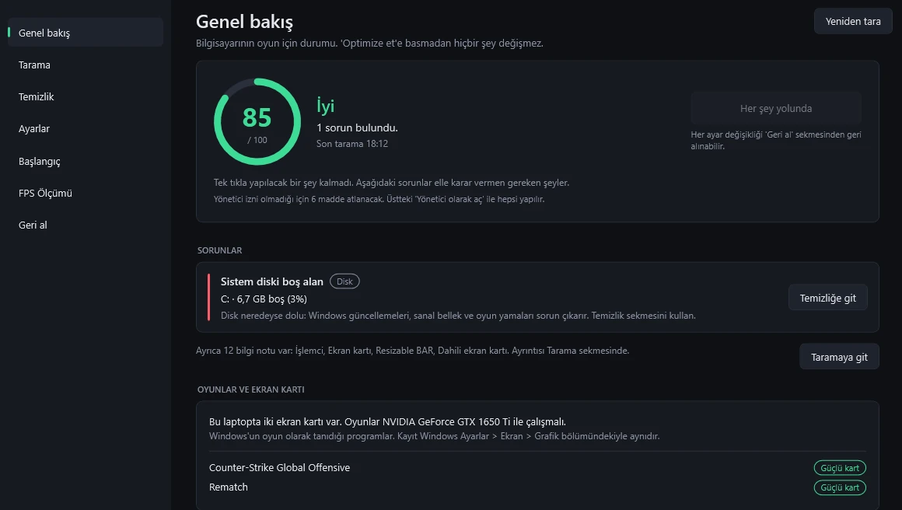
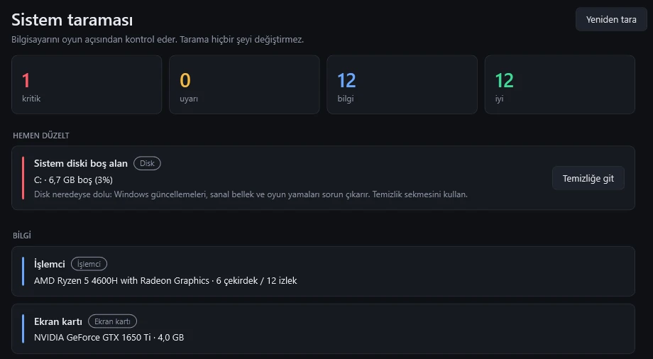
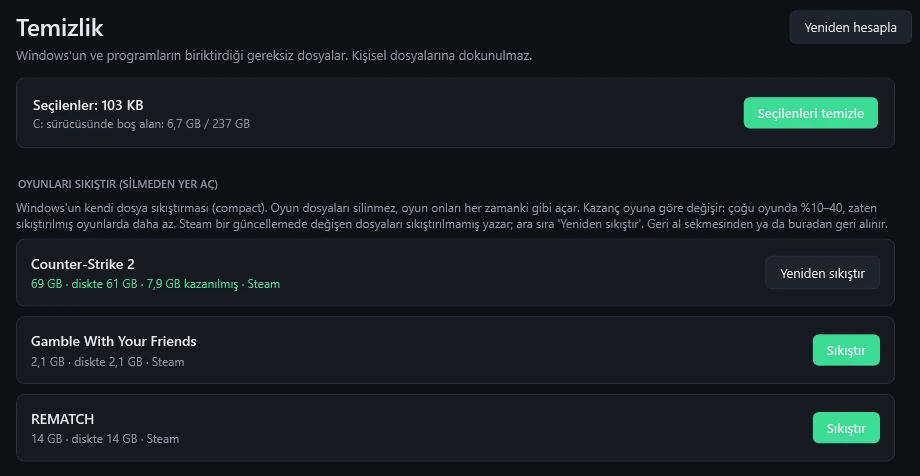
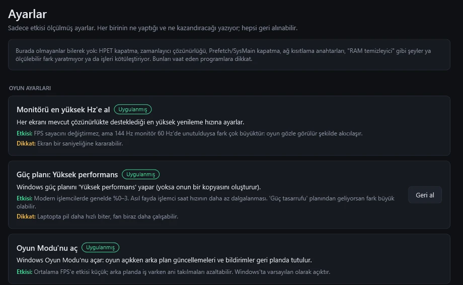
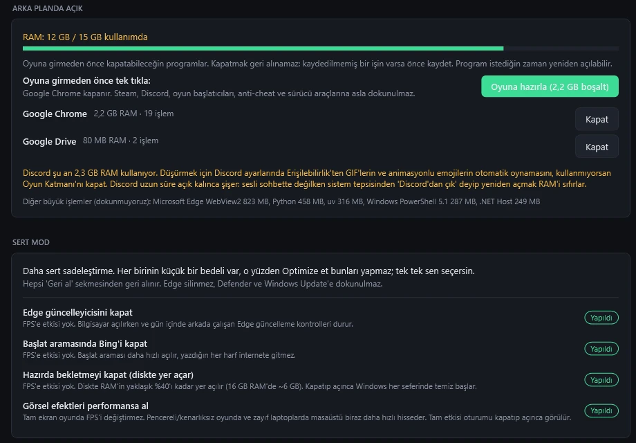
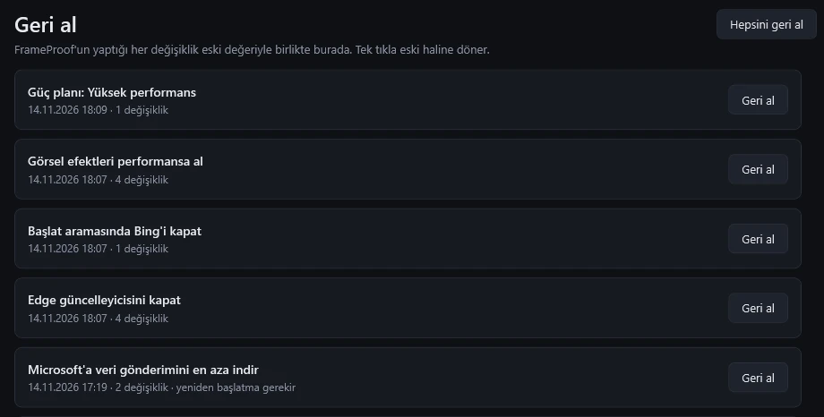

<h1 align="center">FrameProof</h1>

<p align="center">
  <b>Measure. Fix. Prove it.</b><br>
  A free, open-source Windows PC optimizer for gamers that measures before and after every change.
</p>

<p align="center">
  <a href="https://github.com/siiplasplas/FrameProof/releases/latest"></a>
  <a href="https://github.com/siiplasplas/FrameProof/releases"></a>
  <a href="LICENSE"></a>
  
  
</p>

<p align="center">
  <a href="https://github.com/siiplasplas/FrameProof/releases/latest"><b>Download FrameProof.exe</b></a> ·
  <a href="https://getframeproof.pages.dev">Website</a> ·
  <a href="README.tr.md">Türkçe</a>
</p>

<p align="center">
  
</p>

Most "FPS booster" tools flip dozens of registry switches, tell you your PC is faster, and never measure anything.
FrameProof works the other way round:

1. **Scan.** It reads what actually costs frames: RAM running without XMP/EXPO, a monitor stuck at 60 Hz, single-channel RAM,
   the power-saver plan, a full system drive, an old GPU driver, a monitor cable plugged into the motherboard, a laptop game on the integrated GPU.
2. **Fix.** It applies only tweaks with a measurable effect. Every change is journaled with its old value and can be undone in one click.
3. **Clean.** It removes junk safely and can shrink installed games with Windows' own compression, without deleting anything.
4. **Prove.** It captures real frame times with Intel PresentMon, compares before/after runs statistically and says either
   *"real improvement"* or *"no difference"*.

> **What to expect:** on an already-tuned PC, 0–5%. On an untouched PC, 10–25%. On a misconfigured one (XMP off, single stick of RAM,
> monitor stuck at 60 Hz), 30–50% or more. You don't have to trust these numbers: FrameProof measures your own machine.

> [!NOTE]
> The app's interface is currently in **Turkish**. Every action explains itself and asks before changing anything.
> Translations are welcome. See [Contributing](#contributing).

## Screenshots

<table>
  <tr>
    <td width="50%"><br><b>Scan.</b> Read-only. Problems ranked by impact, with a per-machine BIOS guide.</td>
    <td width="50%"><br><b>Cleanup.</b> Shows the size of everything before deleting. Compresses games without removing files.</td>
  </tr>
  <tr>
    <td><br><b>Settings.</b> Each tweak lists what it does, its expected effect and its risk.</td>
    <td><br><b>Prepare for gaming.</b> Closes RAM-hungry apps on a safe list and tells you how many GB were freed.</td>
  </tr>
  <tr>
    <td colspan="2" align="center"><br><b>Undo.</b> Every change FrameProof made, reversible one by one or all at once.</td>
  </tr>
</table>

## Features

| | |
|---|---|
| **Overview and Optimize** | A score out of 100 and an **Optimize** button that lists what it will do and asks first. It never auto-applies anything debatable or anything that needs a reboot. |
| **Scan** | XMP/EXPO, Resizable BAR, Secure Boot, BIOS age, refresh rate, RAM channels, power plan, pagefile, disk space, GPU driver age and more. Changes nothing. |
| **BIOS guide** | Exact menu paths for ASUS, MSI, Gigabyte, ASRock and others, the key to enter setup, and a button that reboots straight into UEFI (`shutdown /r /fw`, with confirmation). BIOS is only *read*, never written. |
| **Laptop and monitor** | Pins games to the dedicated GPU on hybrid laptops (same setting as Windows Settings > Display > Graphics), detects battery/silent modes, MUX/Optimus routing and a monitor cable plugged into the motherboard. |
| **FPS measurement** | Intel PresentMon frame times: average FPS, 1% and 0.1% lows, stutter rate, GPU vs CPU bottleneck, GPU temperature and throttling, whether RAM was enough. |
| **Cleanup** | Temp files, Windows Update cache, crash dumps, GPU driver installer leftovers, browser caches. Personal folders are off-limits. |
| **Compress games** | Steam and Epic games with Windows' built-in WOF compression (`XPRESS16K`, same as `compact /exe`). Typically 10–40% saved. Fully reversible; anti-cheat folders and executables are skipped. |
| **Startup apps** | Turn startup programs on or off, using the same mechanism as Task Manager. |
| **Hard mode** | Optional extra trimming (Edge updater, Copilot, Bing in Start, hibernation, visual effects). Each item lists its cost, and you pick each one yourself. |
| **Undo** | A journal of every change with the original value. |
| **Auto-update** | Checks for new versions on launch. It downloads only when you click, then verifies SHA-256 and size before replacing itself. |
| **CLI** | `frameproof-cli.exe` exposes the same engine for scripting. |

## What FrameProof deliberately does *not* do

These are popular online but have no measurable benefit on modern Windows, or they cause harm:

- **No kernel driver, no game-process access, no anti-cheat interaction.** No conflicts with Vanguard, FACEIT or EAC.
- **No "RAM cleaners".** They flush Windows' file cache, so the game reads from disk again and stutters more.
- **No HPET / `bcdedit` timer tweaks or timer-resolution tools.** Windows 10/11 already handles these.
- **No disabling Prefetch/SysMain, no "network throttling" or TCP registry tweaks.**
- **No touching Defender, Windows Update, the firewall or search indexing.** No uninstalling Edge or system apps.

## How it measures

- **1% low** is the average FPS of the worst 1% of frames (0.1% low is calculated the same way).
- **Average FPS** is time-weighted: total frames divided by total time.
- **Stutter** is the share of frames longer than twice the median frame time.
- **Bottleneck:** GPU busy above 90% means GPU-bound; below 75% means CPU- or game-bound.
- **Comparison:** each run is one sample, and runs are compared with a Welch t-test and a 95% confidence interval. At least 3 runs per side are required.
  If the interval crosses zero or the difference is under 1%, the verdict is **"no difference"**.

## Install

1. Download `FrameProof.exe` from [Releases](https://github.com/siiplasplas/FrameProof/releases/latest) or [getframeproof.pages.dev](https://getframeproof.pages.dev).
   It's a single portable file with no installer, and you don't need to install .NET.
2. Run it and accept the admin prompt. If you decline, it opens in a limited mode.
3. If Windows SmartScreen says *"Windows protected your PC"*, click **More info → Run anyway**.
   This happens because the exe isn't code-signed (a signing certificate is a yearly paid subscription). The source is all here, so you can build it yourself.

Requires Windows 10 or 11, 64-bit.

## Privacy

FrameProof makes only two network requests. One is the update check, which only reads `version.json` and sends nothing.
The other downloads PresentMon from GitHub, and only after you agree; its Intel signature is verified.
There is no telemetry, no account and no ads. Data stays in `%LOCALAPPDATA%\FrameProof`.
If something goes wrong, details are written to `%LOCALAPPDATA%\FrameProof\hata.log`; attach that file to your bug report.

## Command line

```text
frameproof-cli scan [--json]                 Scan the system
frameproof-cli clean                         Calculate reclaimable space (deletes nothing)
frameproof-cli clean --run user_temp,thumbs --yes
frameproof-cli tweaks | tweak <id>           List / apply tweaks
frameproof-cli journal | undo <id|all>       Change journal / undo
frameproof-cli startup [on|off "<name>"]     Startup apps
frameproof-cli measure <game.exe> <sec> <label>
frameproof-cli compare <labelA> <labelB>     Statistical comparison
frameproof-cli games                         GPUs and per-game GPU preference
frameproof-cli space                         Installed games, size, compression state
frameproof-cli optimize                      Show the Optimize plan (doesn't apply)
frameproof-cli selftest                      Run the safety tests
```

## Build from source

Requires the .NET 8 SDK.

```bash
dotnet build
dotnet run --project src/FrameProof.Cli -- selftest
dotnet publish src/FrameProof.App -c Release -r win-x64 --self-contained true -p:PublishSingleFile=true -p:IncludeNativeLibrariesForSelfExtract=true -p:EnableCompressionInSingleFile=true -o dist
```

The main projects: `FrameProof.Core` holds the scan, tweaks, journal, cleanup and measurement logic. `FrameProof.App` is the WPF UI and `FrameProof.Cli` is the command line and tests.

## Contributing

Bug reports and pull requests are welcome. Good places to start:

- **Translations.** The UI is Turkish today; an English UI is the most wanted contribution.
- **BIOS menu paths** for more motherboard and laptop vendors (`src/FrameProof.Core/Scan/BiosGuide.cs`).
- **Measured results.** Open an issue with before/after numbers from your machine.

If you report a bug, please attach `%LOCALAPPDATA%\FrameProof\hata.log`.

## License

[MIT](LICENSE). FrameProof is not affiliated with Intel, NVIDIA, AMD, Microsoft or any game publisher.
