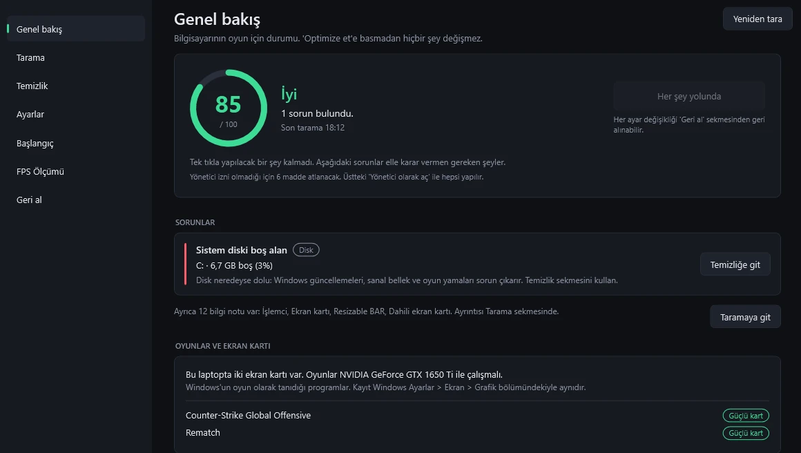

<p align="center"></p>

# FrameProof

[English](README.md) · **Türkçe**

<p align="center"></p>

**Ölç, düzelt, kanıtla.** Oyuncular için ücretsiz ve açık kaynak Windows performans aracı.

Çoğu "FPS artırıcı" program bir sürü ayarı değiştirip "artık daha hızlı" der ama hiçbir şey ölçmez.
FrameProof bunun tersini yapar:

1. **Tarar.** Gerçekten FPS'i etkileyen şeylere bakar: RAM XMP'siz mi çalışıyor, monitör 60 Hz'de mi kalmış,
   tek RAM mi takılı, güç planı tasarrufta mı, disk dolu mu, ekran kartı sürücüsü eski mi…
2. **Düzeltir.** Sadece etkisi ölçülmüş ayarları uygular. Her değişikliğin eski değeri kaydedilir, tek tıkla geri alınır.
3. **Temizler.** Windows'un ve programların biriktirdiği gereksiz dosyaları güvenli biçimde siler.
4. **Kanıtlar.** Intel PresentMon ile oyunun gerçek kare sürelerini ölçer. Önce/sonra ölçümlerini istatistikle
   karşılaştırır ve "gerçek iyileşme" ya da "fark yok" der.

> Beklenti: zaten ayarlı bir bilgisayarda %0–5, hiç dokunulmamış bir bilgisayarda %10–25,
> yanlış kurulmuş (XMP kapalı, tek RAM, 60 Hz'de kalmış monitör) bir bilgisayarda %30–50'nin üstü.
> Bunu FrameProof'un ölçümüyle kendin görürsün.

## İndir ve çalıştır

1. `FrameProof.exe` dosyasını [getframeproof.pages.dev](https://getframeproof.pages.dev) adresinden ya da
   [Releases](https://github.com/siiplasplas/FrameProof/releases/latest) sayfasından indir (kurulum yok, .NET kurmana gerek yok).
2. Çift tıkla. Windows yönetici izni sorar: **Evet** de. (Hayır dersen sınırlı modda açılır.)
3. **"Windows bilgisayarınızı korudu"** mavi ekranı çıkarsa: **Ek bilgi → Yine de çalıştır**.
   Bu uyarı programın kod imzası olmadığı için çıkar (imza sertifikası yıllık ücretli). Kaynak kodu burada, istersen kendin derle.

Gereken: Windows 10 veya 11, 64 bit.

## Sekmeler

| Sekme | Ne yapar |
|---|---|
| **Genel bakış** | Açılış ekranı. 100 üzerinden puan, **Optimize et** düğmesi (önce ne yapacağını listeler, onay ister), laptopta oyunların hangi ekran kartında çalıştığı, Windows'un arka plan özellikleri, açık programlar ve "zaten doğru olanlar". |
| **Tarama** | Sistemi okur, hiçbir şeyi değiştirmez. Sorunları önem sırasına göre listeler; düzeltilebilenlerin yanında "Düzelt" düğmesi var. |
| **Temizlik** | Silinecek her şeyin boyutunu önceden gösterir, sen seçersin. |
| **Ayarlar** | Her ayarın ne yaptığı, beklenen etkisi ve riski yazıyor. |
| **Başlangıç** | Açılışta başlayan programları aç/kapat (Görev Yöneticisi ile aynı yöntem). |
| **FPS Ölçümü** | Oyunu seç, 10 sn geri sayım, ölç. Ortalama FPS, 1% low, 0,1% low, takılma oranı, darboğaz (GPU/CPU), RAM yetti mi. |
| **Geri al** | FrameProof'un yaptığı her değişiklik burada. Tek tek ya da hepsini geri al. |

## Optimize et ne yapar

Tek tıkla yalnızca güvenli olanları yapar: varsayılan seçili temizlik maddeleri (1 MB'tan büyükse) ve riski ya da yeniden başlatması olmayan ayarlar
(oyunları güçlü ekran kartına sabitle, Oyun Modu, Xbox arka plan kaydı, monitör Hz, Windows'un reklam ve arka plan özellikleri; güç planı yalnız "Güç tasarrufu"ndaysa).
Bellek Bütünlüğü, HAGS, telemetri servisi gibi tartışmalı ya da yeniden başlatma isteyenleri **otomatik yapmaz**; programları da kapatmaz.
Bitince kaç MB açıldığını, diskin önce/sonra boş alanını ve hangi ayarların yapıldığını gösterir.

## Laptop: iki ekran kartı

Laptoplarda Windows bazı oyunları işlemcinin içindeki zayıf karta atayabilir (FPS 2–3 kat düşer). FrameProof Windows'un tanıdığı oyunları listeler,
hangisinin hangi karta ayarlı olduğunu gösterir ve tek tıkla güçlü karta sabitler (Windows Ayarlar > Ekran > Grafik ile aynı kayıt, geri alınabilir).
FPS ölçümü sırasında oyunun gerçekten hangi kartta çalıştığını, işlemci hızını, NVIDIA kartın sıcaklığını ve ısıdan yavaşlayıp yavaşlamadığını, laptopun pilde olup olmadığını da okur.

## Windows'u sadeleştir

Hepsi resmi Windows/Edge ilkesi ya da kullanıcı ayarı, hepsi **Geri al** sekmesinden geri alınır:
Edge'in arka planda çalışması ve başlangıç hızlandırması, pencere öğeleri (haber/hava durumu), Başlat menüsü reklamları ve sormadan uygulama kurulumu,
güncellemeleri başka bilgisayarlara yükleme (Teslim İyileştirme), Mağaza uygulamalarının arka planda çalışması, Microsoft'a veri gönderimi (DiagTrack).

**Bilerek dokunmadıklarımız:** Defender, Windows Update, Güvenlik Duvarı, arama dizini. Bunları kapatmak FPS getirmez; bilgisayarı korumasız bırakır ya da güncellemeleri bozar.
Servis ya da uygulama silme yok.

## Sert mod

Genel bakış'ta ve Ayarlar'da ayrı bir grup. **Optimize et bunları yapmaz**; her birinin küçük bir bedeli var, tek tek sen seçersin. Hepsi **Geri al** sekmesinden geri alınır.

| Madde | Ne yapar | Bedeli |
|---|---|---|
| Edge güncelleme servisleri kapalı | `edgeupdate` / `edgeupdatem` servisleri ve zamanlanmış görevleri durur | Edge ve WebView2 güvenlik güncellemesi almaz |
| Copilot kapalı | Copilot ilkesi ve görev çubuğu düğmesi | Windows 11 24H2 ve sonrasında Copilot ayrı uygulama: orada "Gerekmiyor" yazar, Ayarlar > Uygulamalar'dan kaldırılır |
| Başlat aramasında Bing yok | Başlat araması yalnız bilgisayarı arar | Başlat'tan web araması yapılamaz |
| Hazırda bekletme kapalı | `powercfg /hibernate off`, RAM kadar yer açar | Soğuk açılış biraz yavaşlar; geri açmak için diskte o kadar boş yer gerekir |
| Görsel efektler performansa | Animasyon, saydamlık, pencere gölgeleri kapanır | Windows daha düz görünür |

Edge **silinmez**: silinen Edge'i Windows Update geri kurar, WebView2 kullanan uygulamalar (Discord'un bazı parçaları, Teams, widget'lar) bozulur.
Defender ve Windows Update'e Sert mod'da da dokunulmaz.

## RAM (16 GB için)

RAM temizleyici yok, çünkü işe yaramaz: Windows'un önbelleğini boşaltır, oyun o dosyaları yeniden diskten okur, takılma artar. Onun yerine:

- **Oyuna hazırla:** Genel bakış'ta, güvenli listedeki 100 MB üstü programları (tarayıcı, OneDrive, Spotify, Teams vb.) tek onayla kapatır ve kaç GB açıldığını söyler.
  Steam, Discord, başlatıcılar ve anti-cheat'e asla dokunmaz. Kapatmak geri alınamaz: önce açık işini kaydet.
- **Sanal bellek kontrolü:** Taramada sanal belleğin (pagefile) Windows tarafından mı yönetildiğini, elle küçük ayarlanıp ayarlanmadığını ve diskte büyüyecek yer olup olmadığını gösterir.
  16 GB RAM'de sanal bellek küçük ya da disk doluysa oyun çökebilir.
- **FPS ölçümünde RAM:** ölçüm boyunca en az ne kadar RAM boş kaldığına, diske ne kadar sayfa yazıldığına ve kullanım oranına bakar; "RAM yetti" ya da "RAM yetmemiş görünüyor" der.
  Bu bir tahmindir; RAM yetmediyse önce Oyuna hazırla'yı dene.

## Arka planda açık programlar

Genel bakış'ta RAM yiyen programlar listelenir; yalnız güvenli listedekiler (tarayıcılar, OneDrive, Spotify, Teams, Zoom vb.) "Kapat" düğmesiyle kapatılabilir.
Başlatıcılar, anti-cheat, Discord, ekran kartı/ses/fare yazılımları ve sistem işlemleri asla kapatılmaz. **Kapatmak geri alınamaz**: kaydedilmemiş işin varsa önce kaydet.

Discord 800 MB'tan fazla RAM kullanıyorsa FrameProof bunu söyler ve nasıl düşürüleceğini anlatır (GIF ve animasyonlu emoji otomatik oynatma, Oyun Katmanı, uzun süre açık kalınca yeniden başlatma).
Dorion gibi "hafif Discord" istemcilerini önermiyoruz: ölçtüğümüzde WebView2 süreçleriyle birlikte normal Discord'dan **daha çok** RAM kullandı
(1,5 GB'a karşı 855 MB; yalnız diskte ~1,2 GB kazandırıyor), Krisp gürültü engelleme yok ve imzasız. Equicord/Vencord gibi istemci modları Discord kurallarına aykırı olduğu için FrameProof kurmaz.

## Oyunları sıkıştır (silmeden yer aç)

Temizlik sekmesinin en üstünde. Steam ve Epic'te kurulu oyunları kurulum kayıtlarından bulur, her birinin boyutunu ve diskte kapladığı yeri gösterir.
**Sıkıştır**, Windows'un kendi dosya sıkıştırmasını (WOF, `compact /exe:xpress16k` ile aynı) kullanır:

- Dosyalar silinmez, oyun onları her zamanki gibi okur. Kazanç oyuna göre değişir: çoğunda %10–40, zaten paketlenmiş oyunlarda (CS2 gibi) daha az.
- Algoritma XPRESS16K: LZX'ten biraz az sıkıştırır ama açması çok daha hafif, yükleme süresine etkisi küçük olur.
- exe/dll dosyalarına ve anti-cheat klasörlerine (EasyAntiCheat, BattlEye vb.) dokunulmaz. Oyun açıkken başlamaz; istenince durdurulabilir.
- Steam güncellemesinde değişen dosyalar sıkıştırılmamış yazılır; ara sıra **Yeniden sıkıştır**.
- **Geri al** sekmesinden ya da oyunun yanındaki düğmeden geri alınır. Geri almak için diskte kazanılan kadar boş yer gerekir; yoksa FrameProof bunu söyler ve başlamaz.
- SSD'ye bir kez oyun boyutu kadar yazılır.

## Temizlik neleri siler

| Hedef | Not |
|---|---|
| Geçici dosyalar (kullanıcı ve Windows) | Sadece 1 günden eski olanlar; kullanımdaki dosyalar atlanır |
| Windows Update indirme önbelleği | Kurulmuş güncellemelerin indirme dosyaları |
| Teslim İyileştirme önbelleği | Güncellemeleri başka PC'lerle paylaşma dosyaları |
| Çökme dökümleri, hata raporları, eski Windows günlükleri | |
| Küçük resim önbelleği | Windows yeniden oluşturur |
| Ekran kartı sürücü kurulum artıkları | `C:\NVIDIA` ve `C:\AMD` içindeki eski kurulum dosyaları |
| Geri Dönüşüm Kutusu | Varsayılan olarak seçili değil |
| Tarayıcı önbellekleri, Discord ve Steam web önbelleği | Program açıksa atlanır; şifreler ve geçmiş silinmez |
| Windows.old, WinSxS | Varsayılan olarak seçili değil, uyarıyla |

Güvenlik kuralları (kodda zorunlu): kişisel klasörlere dokunulmaz, klasörün kendisi değil sadece içi silinir,
sembolik bağlantı/junction takip edilmez, kilitli dosya atlanır, yasaklı köklerde (C:\, Windows, Program Files, kullanıcı klasörü) silme reddedilir.

## Bilerek yapmadıklarımız

Bunlar internette çok önerilir ama ölçülebilir fayda sağlamaz ya da zarar verir. FrameProof bunları **yapmaz**:

- **HPET kapatma / `bcdedit` zamanlayıcı ayarları:** modern Windows'ta etkisiz ya da kötüleştirici.
- **Zamanlayıcı çözünürlüğü programları:** Windows 11 bunu zaten süreç başına yönetiyor.
- **Prefetch / SysMain kapatma:** SSD'de fayda yok, yükleme sürelerini uzatabilir.
- **"Network throttling" ve TCP kayıt defteri ayarları:** oyun ping'ine etkisi yok.
- **"RAM temizleyiciler":** Windows'un önbelleğini boşaltır, sonra her şey yeniden diskten okunur. Onun yerine yukarıdaki RAM bölümüne bak.
- **Edge'i, Defender'ı ya da Windows Update'i silmek / kapatmak:** FPS getirmez, Windows geri kurar ya da bilgisayar korumasız kalır.
- **Çekirdek sürücüsü, oyun sürecine müdahale, anti-cheat'i kandırma:** asla. FrameProof sürücü yüklemez,
  oyunun belleğine dokunmaz. Valorant/Vanguard, FACEIT, EAC ile sorun çıkarmaz.

## BIOS rehberi

BIOS ayarları (XMP/EXPO, Resizable BAR) Windows'tan güvenli şekilde değiştirilemez; her üreticinin yapısı farklı. FrameProof BIOS'u **yalnız okur**:
sürüm ve tarih (2 yıldan eskiyse güncelleme önerir), Secure Boot, RAM hızı (XMP/EXPO), Resizable BAR.

Yapılacak bir şey varsa **Tarama** sekmesinin başında bu bilgisayara özel bir **BIOS rehberi** çıkar:
anakart/laptop üreticisine göre (ASUS, MSI, Gigabyte, ASRock ve diğerleri) menünün tam yeri, BIOS'a giriş tuşu, neyin ne kazandıracağı.
**BIOS'a yeniden başlat** düğmesi bilgisayarı doğrudan BIOS ekranına açar (Windows'un kendi `shutdown /r /fw` komutu; yalnız UEFI'de, onay ister).

## Diğer kontroller

- **Monitör kablosu anakarta mı takılı?** Masaüstünde monitör ekran kartına değil anakarta takılıysa oyun zayıf işlemci grafikleriyle çalışır. Tarama bunu bulur.
- **Laptop performans modu:** üreticinin uygulamasında (Armoury Crate, MSI Center, Lenovo Vantage…) hangi modun seçileceğini ve kısayolunu söyler.
- **MUX / Optimus:** laptop ekranı işlemci grafikleri üzerinden çalışıyorsa MUX anahtarı (varsa) ya da harici monitör ipucu verir.
- **Pencereli oyunlar için iyileştirmeler:** Windows 11'in kenarlıksız pencere gecikmesini azaltan kendi ayarı. Tek tıkla açılır, geri alınır.

## Güncelleme

Uygulama açılışta `getframeproof.pages.dev/version.json` dosyasına bakar. Yeni sürüm varsa üstte haber verir; **Güncelle**'ye basarsan
yeni exe'yi GitHub Releases'ten indirir, SHA-256 ve boyutunu doğrular, kendini değiştirip yeniden açılır. Doğrulama tutmazsa hiçbir şey değişmez.
Kendiliğinden hiçbir şey kurulmaz. Sol alttaki **Güncellemeleri denetle** ile elle de bakılır.

## Gizlilik

İnternete yalnız iki bağlantı: sürüm kontrolü (yukarıda; yalnız dosya okunur, hiçbir bilgi gönderilmez) ve FPS ölçümü için PresentMon'u
**senin onayınla** GitHub'dan indirmek (Intel imzası doğrulanır). Telemetri yok, hesap yok, reklam yok.
Veriler `%LOCALAPPDATA%\FrameProof` içinde durur. Bir hata olursa ayrıntısı `%LOCALAPPDATA%\FrameProof\hata.log` dosyasına yazılır;
hata bildirirken bu dosyayı eklemen yeter.

## Komut satırı

`frameproof-cli.exe` aynı çekirdeği kullanır:

```
frameproof-cli scan [--json]                 Sistemi tara
frameproof-cli clean                         Temizlenebilir alanı hesapla (silmez)
frameproof-cli clean --run user_temp,thumbs --yes
frameproof-cli tweaks | tweak <id>           Ayarları listele / uygula
frameproof-cli journal | undo <id|all>       Değişiklikler / geri al
frameproof-cli startup [on|off "<ad>"]       Başlangıç uygulamaları
frameproof-cli measure <oyun.exe> <sn> <etiket>
frameproof-cli compare <etiketA> <etiketB>   İstatistikli karşılaştırma
frameproof-cli games                         Ekran kartları ve oyunların kart tercihi
frameproof-cli apps                          Arka planda açık programlar (yalnız listeler)
frameproof-cli space                         Kurulu oyunlar, boyutları ve sıkıştırma durumu (yalnız okur)
frameproof-cli optimize                      Optimize et planını göster (uygulamaz)
frameproof-cli selftest                      Güvenlik testlerini çalıştır
```

## Derleme

.NET 8 SDK gerekir.

```
dotnet build
dotnet run --project src/FrameProof.Cli -- selftest
dotnet publish src/FrameProof.App -c Release -r win-x64 --self-contained true -p:PublishSingleFile=true -p:IncludeNativeLibrariesForSelfExtract=true -p:EnableCompressionInSingleFile=true -o dist
```

Yapı: `FrameProof.Core` (tarama, ayarlar, günlük, temizlik, ölçüm), `FrameProof.App` (WPF arayüz), `FrameProof.Cli` (komut satırı ve testler).

## Nasıl ölçüyoruz

- **1% low** = en kötü %1'lik karelerin ortalama FPS'i (0,1% low aynı şekilde).
- **Ortalama FPS** zamana göre ağırlıklı: toplam kare / toplam süre.
- **Takılma** = ortanca kare süresinin 2 katından uzun karelerin oranı.
- **Darboğaz:** ekran kartı meşguliyeti %90 üstü ise GPU, %75 altı ise CPU/oyun sınırı.
- **Karşılaştırma:** her ölçüm bir örnek; Welch t-testi ile %95 güven aralığı. Her taraf için en az 3 ölçüm şart;
  aralık sıfırı içeriyorsa ya da fark %1'den küçükse sonuç "fark yok".
